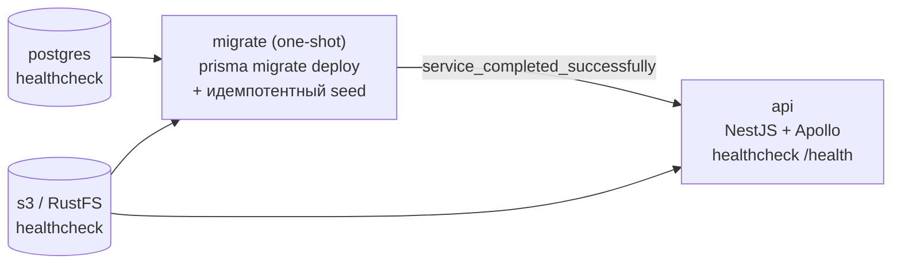
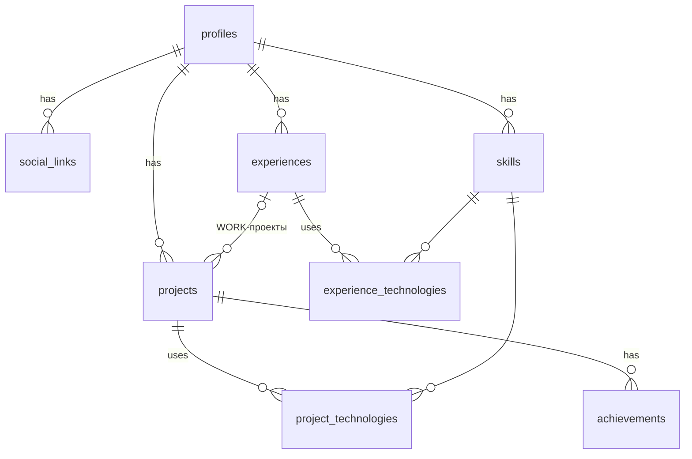

# Digital Business Card API

Цифровая визитка **Тимофея Кочеткова**: backend-приложение на GraphQL, которое отдаёт профиль, навыки,
опыт работы и проекты.

**Стек:** TypeScript · Node.js 24 · NestJS 12 · Apollo Server 5 (GraphQL, code-first) · Prisma 7 ·
PostgreSQL 17 · S3 (RustFS) · Docker Compose · Jest · GitHub Actions.

---

## Быстрый старт

Нужен только Docker.

```bash
git clone <repo-url> && cd digital-business-card
docker compose up --build
```

Через ~30 секунд:

| Что                        | Где                                                           |
| -------------------------- | ------------------------------------------------------------- |
| **GraphiQL** (GraphQL IDE) | http://localhost:3000/graphql                                 |
| Healthcheck (БД + S3)      | http://localhost:3000/health                                  |
| Консоль S3 (RustFS)        | http://localhost:9001 (`card-access-key` / `card-secret-key`) |
| PostgreSQL                 | `localhost:5433` (`card` / `card`)                            |

`.env` не нужен: у всех переменных в `docker-compose.yml` есть значения по умолчанию.
Порт Postgres на хосте — **5433**, чтобы не конфликтовать с локально установленным PostgreSQL.

### Что происходит при запуске



1. `postgres` и `s3` стартуют и проходят healthcheck.
2. Одноразовый контейнер `migrate` применяет миграции и заполняет БД, загружает аватар в S3.
3. `api` стартует **только после успешного** завершения `migrate` и сам становится healthy, когда отвечают БД и S3.

Повторный `docker compose up` безопасен: миграции уже применены, сид приводит данные к тому же состоянию.

---

## Примеры запросов

Запрос из задания:

```graphql
query {
  profile {
    fullName
    description
    skills {
      name
    }
    experience {
      company
      position
    }
    projects {
      name
    }
  }
}
```

Всё, что умеет API:

```graphql
query FullProfile {
  profile {
    # без аргумента — владелец визитки; profile(id: "...") — по id
    fullName
    headline
    description
    location
    avatarUrl # постоянная публичная ссылка на фото в S3 (кэшируется)
    links {
      kind
      label
      url
    }
    totalExperience {
      years
      months
      text
    } # "4 года 9 месяцев", пересечения периодов не дублируются
    skillGroups {
      category
      skills {
        name
      }
    }
    experience {
      company
      position
      period # "Март 2025 — настоящее время"
      isCurrent
      startDate # LocalDate: "2025-03-01"
      duration {
        text
        totalMonths
      }
      technologies {
        name
        category
      }
      projects {
        name
      }
    }
    projects(featured: true) {
      name
      kind # WORK | SIDE | PET
      description
      repositoryUrl # null у закрытых репозиториев
      demoUrl
      experience {
        company
      }
      achievements {
        text
      }
      technologies {
        name
      }
    }
  }
}
```

Контракт API лежит в [`schema.gql`](schema.gql): он генерируется из кода при `start:dev` и `test:e2e` (везде, кроме
production) и коммитится — изменения схемы видны в diff. Файл — артефакт генератора, поэтому исключён из prettier;
CI после e2e выполняет `npm run schema:check` и падает, если сгенерированная схема не совпадает с закоммиченной.

### GraphiQL в production

Фронтенда у визитки нет, поэтому страница для тестирования запросов работает и в production: `GET /graphql` из
браузера открывает встроенный в `@nestjs/apollo` GraphiQL, `POST /graphql` — сам API. По умолчанию Nest включает
GraphiQL только вне production, поэтому флаг задан явно (`graphiql: GRAPHQL_SANDBOX`) вместе с интроспекцией — без
неё в GraphiQL не работают документация и автодополнение. Выключить обе: `GRAPHQL_SANDBOX=false`.

---

## Архитектура

### Структура

```
src/
├── main.ts
├── app.module.ts      инфраструктура и транспорт; бизнес-модули подключаются через ApiModule
├── config/            env.schema.ts — zod-схема окружения (приложение не стартует с невалидным env)
├── graphql/           graphql.config.ts, контекст запроса, маппинг ошибок, лимиты сложности запроса,
│                      скаляры (LocalDate), pipes (ParseIdPipe)
├── infra/
│   ├── prisma/        PrismaService — lifecycle, driver adapter pg, подписка на SQL-события
│   └── storage/       S3Storage — framework-agnostic шлюз к S3 (используется и API, и сидом)
├── common/
│   ├── dataloader/    LoaderRegistry (DataLoader на запрос), groupByKeys, @Loaders()
│   ├── errors/        DomainError, NotFoundError
│   ├── models/        BaseModel
│   └── clock/         Clock — абстракция времени для детерминированной бизнес-логики
├── health/            /health (terminus): БД + S3
└── modules/
    ├── api.module.ts  собирает все бизнес-модули
    ├── profile/       Query.profile, Profile.links, Profile.avatarUrl
    ├── skill/         Profile.skills, Profile.skillGroups + loader'ы стеков технологий
    ├── experience/    Profile.experience, Profile.totalExperience, Experience.*
    └── project/       Profile.projects, Experience.projects, Project.technologies/experience
prisma/
├── schema.prisma
├── migrations/        SQL-миграции (коммитятся)
└── seed/              типизированные данные + декларативная синхронизация
test/                  e2e
```

### Слои и разделение ответственности

| Слой         | Отвечает за                                                                                                                              | Не делает                         |
| ------------ | ---------------------------------------------------------------------------------------------------------------------------------------- | --------------------------------- |
| **Resolver** | форма GraphQL API, аргументы, делегирование                                                                                              | не ходит в БД, не содержит правил |
| **Service**  | запросы к БД через Prisma (всегда батчевые `IN (...)` и с `orderBy`) и бизнес-правила: длительность опыта, группировка, ссылка на аватар | не знает про GraphQL              |
| **Loaders**  | батч-функции для DataLoader поверх методов сервиса                                                                                       | не кэширует между запросами       |
| **Models**   | публичный GraphQL-контракт (`*Model`), отделён от Prisma-типов                                                                           | —                                 |

Отдельного слоя репозиториев нет: `PrismaClient` уже является типизированным data mapper'ом, и обёртка над ним
дублировала бы каждый метод один к одному. Чистые правила живут в отдельных файлах без БД и фреймворка
(`experience-period.ts`, `skill-grouping.ts`, `project-filter.ts`) и тестируются без моков; сервис вызывает их и
остаётся единственной точкой входа для резолверов.

GraphQL-модели сверяются с Prisma через `implements Pick<PrismaModel, 'field' | …>`: типы выставленных полей
проверяет компилятор, но выставлять все колонки таблицы не обязательно — `avatarKey` (ключ объекта в S3) и служебные
метки времени в контракт не входят.

**Модули расширяют `Profile` сами.** Тип `Profile` объявлен в `profile`-модуле, но поля `skills`, `experience`,
`projects` добавляются резолверами _своих_ модулей (`@Resolver(() => ProfileModel)`). Профиль ничего не знает о
навыках и проектах: новый раздел визитки (например, «Образование») — это новый модуль без правок существующих.

### GraphQL и N+1

Каждая связь резолвится через **DataLoader**, а не через запрос на каждый родительский объект.

- Батч-функции живут в singleton-провайдерах (`SkillLoaders`, `ExperienceLoaders`, …).
- Экземпляры DataLoader создаются лениво **на каждый запрос** в `LoaderRegistry`, который кладётся в контекст Apollo.
  Так кэш изолирован между запросами, а DI-граф не становится request-scoped (`Scope.REQUEST` в Nest пересоздавал
  бы всю цепочку зависимостей на каждый запрос).
- Поля, которые используют одни и те же данные, разделяют один батч: `skills` и `skillGroups`, `experience` и
  `totalExperience`, `projects` и `projects(featured: true)` — один SQL-запрос на пару.

Итог для `FullProfile` (3 уровня вложенности, все связи) — **10 SQL-запросов, независимо от количества
записей**: profile, social_links, skills, experiences, experience_technologies (+ skills), projects,
achievements, project_technologies (+ skills). Это закреплено e2e-тестом, который считает SQL через `PrismaService.onQuery`.
Посмотреть вживую: `PRISMA_LOG_QUERIES=true`.

<details>
<summary>Почему DataLoader, а не <code>include</code> по AST запроса</summary>

| Подход                                              | Минусы                                                                                                                             |
| --------------------------------------------------- | ---------------------------------------------------------------------------------------------------------------------------------- |
| Prisma `include`, построенный из `info` (lookahead) | Резолвер привязан к форме запроса; сложно поддерживать при росте схемы; плохо работает с алиасами и аргументами на вложенных полях |
| Fluent API Prisma                                   | Батчит только `findUnique`, не решает задачу в общем виде                                                                          |
| **DataLoader**                                      | Независимые резолверы, батчинг на любом уровне вложенности, предсказуемое число запросов                                           |

</details>

### База данных



- **Навыки — единый справочник.** Стек проектов и мест работы ссылается на те же `skills` через явные join-таблицы
  с `sort_order`, поэтому «NestJS» в навыках, опыте и проектах — одна сущность.
- **Целочисленные автоинкрементные** первичные ключи (`SERIAL`): компактные и читаемые; наружу API отдаёт их как GraphQL `ID`.
- **Ограниченные по длине строки**: короткие поля — `VARCHAR(n)` (URL — 2048), длинные тексты (описания, достижения) — `TEXT`;
  порядок сортировки — `SMALLINT`.
- **Индексы** на всех FK и составные `(profile_id, sort_order)` / `(profile_id, start_date DESC)` под реальные запросы.
- **Один профиль — владелец визитки**: сид обновляет его на месте, `profile` без аргументов возвращает его.
- **Уникальные натуральные ключи** (`(profile_id, name)`, `(profile_id, company, start_date)`, у достижений —
  `(project_id, sort_order)`) — на них опирается идемпотентный сид, поэтому id, которые видит API, стабильны.
- **`DATE`** для периодов работы (а не timestamp) и отдельный GraphQL-скаляр `LocalDate` (`YYYY-MM-DD`): у даты
  начала работы нет часового пояса. Служебные метки — `timestamptz`.
- **CHECK-ограничения** `end_date >= start_date` у опыта и «`kind = WORK` ⇔ задан `experience_id`» у проектов дописаны
  в миграции вручную — Prisma не умеет описывать CHECK в схеме.
- `ON DELETE CASCADE` для всех дочерних сущностей; snake_case в БД, camelCase в коде (`@map`/`@@map`).

### Инициализация и заполнение БД

- **Миграции** (`prisma migrate deploy`) и **сид** выполняются отдельным one-shot сервисом `migrate`, а не при старте API:
  при нескольких репликах API миграции не запустятся конкурентно, а рантайм-образу не нужны Prisma CLI и права на DDL.
- **Данные — это код** (`prisma/seed/data/profile.ts`), типизированные интерфейсом `ProfileSeed`.
- **Валидация до записи**: дубли натуральных ключей, ссылки на несуществующие навыки, некорректные периоды —
  сид падает до того, как что-то изменит.
- **Декларативная синхронизация**: каждая сущность upsert'ится по натуральному ключу (ID стабильны между запусками),
  отсутствующие в сиде строки удаляются. Всё — в одной транзакции. Запуск N раз = один и тот же результат.
- Файлы (аватар) загружаются в S3 до транзакции: объектное хранилище не транзакционно, а ключ по содержимому
  делает повторную загрузку безопасной — тот же файл попадает в тот же объект.

### S3

Аватар — **публичный объект** с постоянной ссылкой: фото визитки и так публично, а presigned URL менялся бы на
каждый запрос и не кэшировался.

- **Публичен только префикс `public/`.** Сид выставляет политику бакета «анонимное `GetObject` на `public/*`»; всё
  остальное в бакете остаётся приватным (e2e проверяет и 200 для аватара, и 403 для чужого ключа).
- **Ключ по содержимому**: `public/avatars/<sha256[:16]>.jpg`. Новое фото — новый ключ и новая ссылка, поэтому
  объект отдаётся с `Cache-Control: public, max-age=31536000, immutable` и вопрос инвалидации кэша не возникает.
- **Ссылка строится без сети** из `S3_PUBLIC_ENDPOINT` (path-style `…/<bucket>/<key>` или virtual-hosted
  `<bucket>.<host>/<key>`): внутри Docker API ходит в `http://s3:9000`, а браузеру нужен `http://localhost:9000`.
  Для CDN или домена Cloudflare R2 задаётся `S3_PUBLIC_URL` — тогда ссылка `<S3_PUBLIC_URL>/<key>`.
- На AWS S3 для публичной политики у бакета нужно снять Block Public Access; Yandex Object Storage и R2 настраивают
  публичный доступ своими средствами (политика бакета / публичный домен).

Локально используется **RustFS** (Apache-2.0): MinIO перестал публиковать community-образы. Код работает через
стандартный AWS SDK v3 и переключается на AWS S3 / Yandex Object Storage / любой S3-совместимый сервис через env.

### Ошибки

Бизнес-ошибки (`DomainError`) не зависят от транспорта; на уровне GraphQL они получают `extensions.code`.
Неожиданные ошибки в production маскируются (`Internal server error`, без стектрейса и SQL),
в development — показываются полностью.

| Код                         | HTTP | Когда                                                                               |
| --------------------------- | ---- | ----------------------------------------------------------------------------------- |
| `NOT_FOUND`                 | 200  | профиль с таким id не существует                                                    |
| `BAD_USER_INPUT`            | 200  | id не является положительным int4 (`"abc"`, `"0"`, `"99999999999"`) — `ParseIdPipe` |
| `GRAPHQL_VALIDATION_FAILED` | 400  | несуществующее поле, неверный enum, превышены лимиты сложности запроса              |
| `INTERNAL_SERVER_ERROR`     | 200  | непредвиденный сбой (в production — без деталей)                                    |

Глобальный фильтр `DomainErrorFilter` регистрируется через `{ provide: APP_FILTER, useClass }`, а не
`app.useGlobalFilters()`: так он создаётся DI-контейнером и действует и в e2e, где `main.ts` не выполняется.
Фильтр лишь не даёт Nest логировать ожидаемые ошибки как сбои; маппинг в коды делает `format-graphql-error.ts`.

### Docker

Один multi-stage `Dockerfile`, несколько target'ов:

| Stage       | Назначение                                             |
| ----------- | ------------------------------------------------------ |
| `deps`      | `npm ci` + генерация Prisma Client                     |
| `build`     | компиляция TypeScript                                  |
| `migrator`  | Prisma CLI + tsx для миграций и сида                   |
| `prod-deps` | только runtime-зависимости, без CLI и dev-инструментов |
| `runtime`   | `node:24-alpine`, non-root пользователь, `HEALTHCHECK` |

---

## Разработка

```bash
nvm use                   # Node 24 из .nvmrc; на другой версии npm ci упадёт (engine-strict)
npm ci
cp .env.example .env
docker compose up -d postgres s3
npm run db:setup          # миграции + сид
npm run start:dev         # http://localhost:3000/graphql
```

| Команда                                                       |                                                                                 |
| ------------------------------------------------------------- | ------------------------------------------------------------------------------- |
| `npm test` / `npm run test:cov`                               | unit-тесты (бизнес-логика, DataLoader, маппинг ошибок, скаляры, валидация сида) |
| `npm run test:e2e`                                            | e2e на реальных PostgreSQL и S3, включая проверку числа SQL-запросов            |
| `npm run lint` / `npm run typecheck` / `npm run format:check` | качество кода                                                                   |
| `npm run db:migrate:dev -- --name <name>`                     | новая миграция после изменения `schema.prisma`                                  |

CI (GitHub Actions): lint + typecheck + unit с покрытием → e2e с PostgreSQL и S3 → полный `docker compose up --build`
с проверкой ответа API — ровно тот сценарий, который выполнит проверяющий.

### Переменные окружения

Описаны и валидируются в [`src/config/env.schema.ts`](src/config/env.schema.ts), пример — [`.env.example`](.env.example).

| Переменная                                                 | По умолчанию |                                         |
| ---------------------------------------------------------- | ------------ | --------------------------------------- |
| `GRAPHQL_SANDBOX`                                          | `true`       | GraphiQL и introspection                |
| `GRAPHQL_MAX_DEPTH`                                        | `6`          | максимальная глубина запроса            |
| `GRAPHQL_MAX_ALIASES`                                      | `15`         | максимум алиасов в операции             |
| `GRAPHQL_MAX_COST`                                         | `1000`       | максимальная статическая стоимость      |
| `PRISMA_LOG_QUERIES`                                       | `false`      | логировать SQL (наглядно видно батчинг) |
| `DATABASE_URL`                                             | —            | строка подключения PostgreSQL           |
| `S3_ENDPOINT` / `S3_PUBLIC_ENDPOINT`                       | —            | адрес S3 для API / для ссылок браузеру  |
| `S3_PUBLIC_URL`                                            | —            | база публичных ссылок (CDN, домен R2)   |
| `S3_BUCKET`, `S3_ACCESS_KEY`, `S3_SECRET_KEY`, `S3_REGION` | —            | доступ к S3                             |

---

## Осознанные решения и компромиссы

- **API только на чтение.** Визитка — публичная витрина; данные меняются через код сида и ревью, а не через
  мутации. Мутации потребовали бы аутентификации, что выходит за рамки задачи.
- **Схема циклическая, поэтому сложность запроса ограничена правилами валидации.** Связь проекта с местом работы
  доступна в обе стороны (`Project.experience ↔ Experience.projects`), и без ограничений запрос в ~1 КБ раздувает
  ответ экспоненциально и роняет процесс по памяти. Каждый запрос до выполнения проверяется на глубину (≤ 6), число
  алиасов (≤ 15) и статическую стоимость (≤ 1000); превышение — HTTP 400 без единого SQL-запроса. Разбор проблемы,
  замеры, выбор значений и подводные камни — в [docs/graphql-query-limits.md](docs/graphql-query-limits.md).
  Пагинация не добавлена: объём данных визитки — десятки записей.
- **NestJS 12 распространяется как ESM**, приложение остаётся CommonJS (как в официальном шаблоне Nest 12) и
  подключает Nest через `require(esm)` Node 24.
- **TypeScript 6**, а не 7: TS 7 ещё не поддерживается `@nestjs/graphql`, `ts-jest` и `typescript-eslint`.
- **`graphql@16`**: Apollo Server 5 требует `^16.11`.

## Использование Claude Code

Проект разрабатывался с Claude Code: исследование актуальных версий и их совместимости, генерация каркаса,
ревью архитектурных решений, тесты. Правила проекта для агента — в [`CLAUDE.md`](CLAUDE.md).

---

**Контакты:** [GitHub](https://github.com/Timovey) · [Telegram @timovey73](https://t.me/timovey73) ·
kochetkovtimofey73@gmail.com
