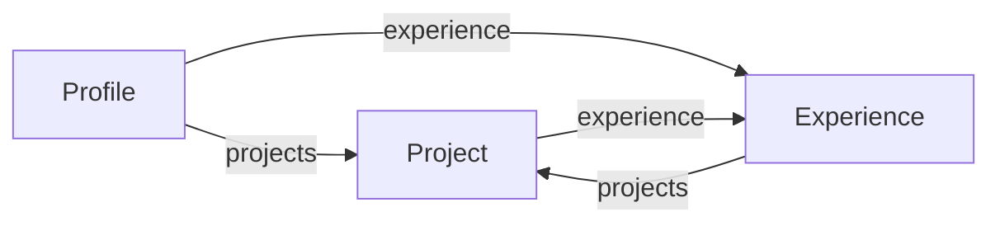

# Лимиты сложности GraphQL-запросов

> **Коротко.** В схеме есть цикл `Project.experience ↔ Experience.projects`. Без ограничений
> запрос размером ~1 КБ раздувает ответ экспоненциально и роняет процесс API по памяти
> (`JavaScript heap out of memory`). Поэтому каждый запрос до выполнения проходит три правила
> валидации — **глубина ≤ 6, алиасов ≤ 15, статическая стоимость ≤ 1000** — и при превышении
> отклоняется с HTTP 400 и `GRAPHQL_VALIDATION_FAILED`, не сделав ни одного SQL-запроса.

Код: [`src/graphql/query-limits.ts`](../src/graphql/query-limits.ts), подключение —
[`src/graphql/graphql.config.ts`](../src/graphql/graphql.config.ts), настройки — `GRAPHQL_MAX_*`
в [`src/config/env.schema.ts`](../src/config/env.schema.ts).

---

## 1. Проблема

### 1.1. Цикл в схеме



Связь «проект сделан на этом месте работы» доступна в обе стороны: `Project.experience` и
`Experience.projects`. Это удобно клиенту, но делает граф типов циклическим, а значит, глубина
запроса схемой **не ограничена**:

```graphql
{ profile { projects { experience { projects { experience { projects { … } } } } } } }
```

### 1.2. Почему ответ растёт экспоненциально

В GraphQL форму ответа задаёт клиент, и сервер честно строит дерево для каждого родителя.
Один виток цикла (`experience { projects { … } }`) превращает каждый проект в _все_ проекты его
места работы. Если на месте работы `E` сделано `n_E` проектов, то после `t` витков число узлов
на нижнем уровне:

```
N(t) = Σ_E  n_E^(t+1)
```

В данных визитки `n = { WONE IT: 1, Шевиант: 3, Экоинформ: 1 }`, то есть `N(t) ≈ 3^(t+1)`:

| Глубина запроса   | Витков `t` | Узлов на нижнем уровне |
| ----------------- | ---------- | ---------------------- |
| 6 (текущий лимит) | 1          | 3² + 1 + 1 = 11        |
| 8                 | 2          | ≈ 3³ = 29              |
| 20                | 8          | ≈ 3⁹ ≈ 20 тыс.         |
| 80                | 38         | ≈ 3³⁹ ≈ 4·10¹⁸         |

Рост задают **данные**, а не запрос: стоит добавить место работы с 10 проектами, и основание
степени станет 10. Запрос при этом растёт линейно — 80 уровней это ~1,1 КБ текста.

### 1.3. Почему DataLoader не спасает

DataLoader решает другую задачу — число SQL-запросов. Он и здесь отработал идеально: запрос глубиной
8 сделал **4 SQL**, потому что повторные `experience(id)` и `projects(experienceId)` берутся из кэша
запроса. Но кэш возвращает те же объекты, а GraphQL всё равно строит для них отдельные ветки
ответа: резолвит поля, собирает объекты, сериализует JSON. Взрывается не база, а **память и CPU
процесса Node.js**.

### 1.4. Воспроизведение

Замеры на локальном API с выключенными лимитами:

| Запрос                          | Размер запроса | Результат                                                                                         |
| ------------------------------- | -------------- | ------------------------------------------------------------------------------------------------- |
| цикл, глубина 8                 | ~150 Б         | 200 OK, 4 SQL, ответ 22 КБ                                                                        |
| цикл, глубина 80                | ~1,1 КБ        | `FATAL ERROR: Reached heap limit … JavaScript heap out of memory`, процесс завершился с кодом 134 |
| 200 алиасов `pN: profile { … }` | ~5 КБ          | 200 OK — каждый алиас резолвится отдельно (включая подпись URL аватара)                           |

В Docker контейнер перезапустится (`restart: unless-stopped`), но повторять запрос можно
бесконечно — это отказ в обслуживании одним анонимным HTTP-запросом.

---

## 2. Решение: три правила валидации

GraphQL выполняет запрос в три фазы: **parse → validate → execute**. Правила валидации работают
на AST до выполнения: дорогой запрос отклоняется, не дойдя ни до резолверов, ни до базы.
Используются отдельные правила из [graphql-armor](https://escape.tech/graphql-armor/) — они
подключаются как обычные `validationRules` Apollo без дополнительных зависимостей.

### 2.1. Почему нужны все три

Каждое правило закрывает свой вектор и пропускает чужой. Значения измерены на этой схеме:

| Запрос                  | Глубина | Стоимость | Алиасы | Кто ловит           |
| ----------------------- | ------- | --------- | ------ | ------------------- |
| FullProfile из README   | 4       | 125       | 0      | — (легитимный)      |
| с фрагментами `...Tech` | 5       | 81        | 0      | — (легитимный)      |
| цикл, глубина 8         | 8       | **81**    | 0      | только **глубина**  |
| 200 алиасов `profile`   | 2       | **700**   | 200    | только **алиасы**   |
| цикл, глубина 80        | 80      | 4·10¹⁴    | 0      | глубина и стоимость |

- **Глубина** (`maxDepthRule`) — главная защита от цикла. Стоимость её не заменяет: цикл
  глубиной 8 стоит всего 81, меньше полного профиля.
- **Алиасы** (`maxAliasesRule`) — от «ширины»: один и тот же дорогой корень, повторённый сотни
  раз. Глубина у такого запроса 2, а стоимость 700 — ниже лимита.
- **Стоимость** (`costLimitRule`) — общий бюджет на «широкие и в меру глубокие» запросы.
  Считается статически: объект — 2, скаляр — 1, каждый уровень вложенности ×1.5.

### 2.2. Выбор значений

| Лимит                 | Значение | Легитимный максимум сейчас                          | Запас      |
| --------------------- | -------- | --------------------------------------------------- | ---------- |
| `GRAPHQL_MAX_DEPTH`   | 6        | 5 (`profile.experience.projects.technologies.name`) | +1 уровень |
| `GRAPHQL_MAX_ALIASES` | 15       | 3 (`featured/side/work`)                            | ×5         |
| `GRAPHQL_MAX_COST`    | 1000     | 125 (FullProfile)                                   | ×8         |

Глубина 6 оставляет ровно один виток цикла (`projects → experience → projects`), которого
хватает любому реальному экрану; худший случай на текущих данных — **707 байт** ответа.

> Как считается глубина: **каждое поле, включая листовое, — уровень**.
> `{ profile { skills { name } } }` — глубина 3. Фрагменты уровней не добавляют
> (`flattenFragments: true`), иначе переход на фрагменты ломал бы легитимные запросы.

### 2.3. Подключение

```ts
// src/graphql/graphql.config.ts
validationRules: createQueryLimitRules({
  maxDepth: config.get('GRAPHQL_MAX_DEPTH', { infer: true }),
  maxAliases: config.get('GRAPHQL_MAX_ALIASES', { infer: true }),
  maxCost: config.get('GRAPHQL_MAX_COST', { infer: true }),
}),
```

Ответ при превышении:

```json
HTTP 400
{ "errors": [{
  "message": "Syntax Error: Query depth limit of 6 exceeded, found 80.",
  "extensions": { "code": "GRAPHQL_VALIDATION_FAILED" }
}] }
```

С лимитами тот же запрос глубиной 80 отклоняется за ~80 мс, процесс продолжает работать.

### 2.4. Подводный камень: `propagateOnRejection`

По умолчанию правила graphql-armor при превышении **бросают** исключение
(`propagateOnRejection: true`), а не сообщают об ошибке через `context.reportError()`.
Apollo Server вызывает `validate()` без `try/catch` (`requestPipeline` → `validate(...)`), поэтому
брошенная ошибка ушла бы по пути _внутренних_ ошибок:

- клиент получил бы `INTERNAL_SERVER_ERROR` вместо `GRAPHQL_VALIDATION_FAILED`;
- в production наш `formatError` замаскировал бы сообщение до `Internal server error` —
  клиент не узнал бы, что превысил лимит и какой;
- мониторинг считал бы это сбоем сервера.

Поэтому правила подключены с `propagateOnRejection: false` и обработчиком
`onReject: [(ctx, error) => ctx?.reportError(error)]` — ошибка идёт штатным путём валидации.
Это закреплено unit-тестом «rejects … without throwing».

### 2.5. Интроспекция

Стандартный запрос интроспекции (его шлют GraphiQL, codegen, IDE-плагины) глубже 6 уровней.
Правила глубины и стоимости пропускают поддерево `__schema` (`ignoreIntrospection: true`
по умолчанию), поэтому GraphiQL продолжает работать — это тоже покрыто тестами.
Интроспекция намеренно включена и в production: GraphiQL — витрина API (фронтенда нет), без
интроспекции в нём не работали бы документация и автодополнение. Выключить обе можно через
`GRAPHQL_SANDBOX=false`. Схема публичная по задумке, поэтому интроспекция ничего не раскрывает;
защиту от дорогих запросов дают лимиты, а не скрытие схемы.

---

## 3. Тесты

| Уровень | Файл                                                          | Что проверяет                                                                                                                                                                                  |
| ------- | ------------------------------------------------------------- | ---------------------------------------------------------------------------------------------------------------------------------------------------------------------------------------------- |
| unit    | [`query-limits.spec.ts`](../src/graphql/query-limits.spec.ts) | точная граница глубины (6 — да, 7 — нет); фрагменты не добавляют уровней; алиасы; стоимость ловит запрос при широких лимитах глубины; интроспекция проходит; правило **не бросает** исключение |
| e2e     | [`graphql.e2e-spec.ts`](../test/graphql.e2e-spec.ts)          | цикл ровно на лимите отдаётся; глубина 80 → **HTTP 400**, `GRAPHQL_VALIDATION_FAILED`, **0 SQL-запросов**; лишний алиас → 400; интроспекция проходит                                           |

E2E берёт лимиты из `ConfigService`, поэтому тесты остаются верными при изменении env.

## 4. Как менять лимиты

1. Если новый экран клиента упирается в лимит — сначала проверьте, не лишний ли там виток цикла.
2. Узнать глубину/стоимость конкретного запроса проще всего временно выставив маленький лимит
   (`GRAPHQL_MAX_COST=1`): сообщение об ошибке содержит фактическое значение (`found N`).
3. Меняйте значения через env (`GRAPHQL_MAX_DEPTH`, `GRAPHQL_MAX_ALIASES`, `GRAPHQL_MAX_COST`) и
   обновите таблицу в §2.2.
4. **Добавляя в схему новую двустороннюю связь**, пересчитайте худший случай по формуле из §1.2:
   основание степени — максимальное число детей у одного родителя.

## 5. Что лимиты не покрывают

| Риск                                        | Почему лимиты не помогают                                                                                                                   | Что делать                                                                                                                    |
| ------------------------------------------- | ------------------------------------------------------------------------------------------------------------------------------------------- | ----------------------------------------------------------------------------------------------------------------------------- |
| Большие списки                              | Стоимость статическая: она не знает, что `projects` вернёт 5 или 5000 элементов. Множитель учитывается только для аргументов `first`/`last` | Пагинация (`first`/`after`) для любых растущих списков — тогда cost-limit умножает стоимость на `first`                       |
| Огромный текст запроса                      | Валидация идёт после парсинга                                                                                                               | Лимит тела запроса (body-parser в Nest по умолчанию — 100 КБ); при необходимости — лимит токенов (`graphql-armor-max-tokens`) |
| Много запросов подряд                       | Лимиты — на один запрос                                                                                                                     | Rate limiting: `@nestjs/throttler` или на прокси/ingress                                                                      |
| Медленные резолверы                         | Валидация не знает реального времени                                                                                                        | Таймауты запросов к БД и внешним сервисам                                                                                     |
| HTTP-батчинг (массив операций в одном POST) | —                                                                                                                                           | В Apollo Server 4+ выключен по умолчанию (`allowBatchedHttpRequests: false`) — не включать без лимита на размер батча         |

Для API с одним «своим» клиентом самая сильная защита — **persisted queries / allowlist**:
сервер выполняет только заранее зарегистрированные запросы, и произвольный запрос атакующего
просто не принимается.

## 6. Рассмотренные альтернативы

| Вариант                                                    | Почему не выбран                                                                                                                                                |
| ---------------------------------------------------------- | --------------------------------------------------------------------------------------------------------------------------------------------------------------- |
| Разорвать цикл: оставить только `Project.experience`       | Ломает публичный контракт и удобный клиенту сценарий «проекты места работы». Лимит глубины сохраняет обе связи                                                  |
| `graphql-depth-limit`                                      | Не обновлялся с 2018 года; закрывает только глубину                                                                                                             |
| `graphql-query-complexity`                                 | Точнее (оценщики на уровне полей, учёт аргументов), но требует описывать стоимость полей; для визитки избыточно                                                 |
| Полный пакет `@escape.tech/graphql-armor`                  | Тянет `@envelop/core` и включает ещё и `blockFieldSuggestion` (прячет подсказки «Did you mean…», полезные в GraphiQL). Отдельные правила дают то же без лишнего |
| Лимиты на уровне шлюза (Apollo Router demand control, WAF) | Уместно при наличии шлюза; в этом проекте его нет, а защита в приложении работает в любом окружении, включая локальное и e2e                                    |
